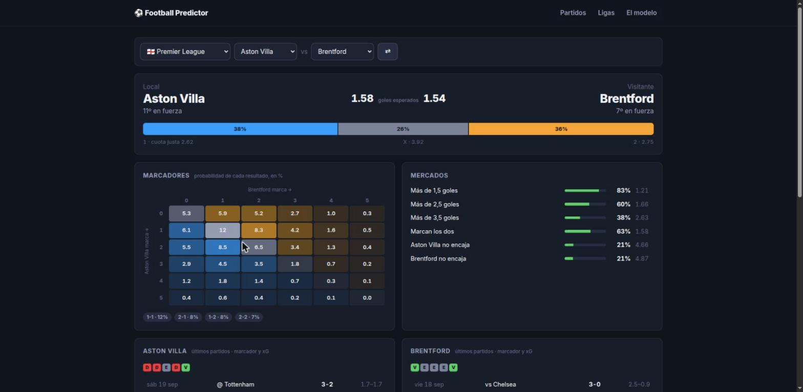
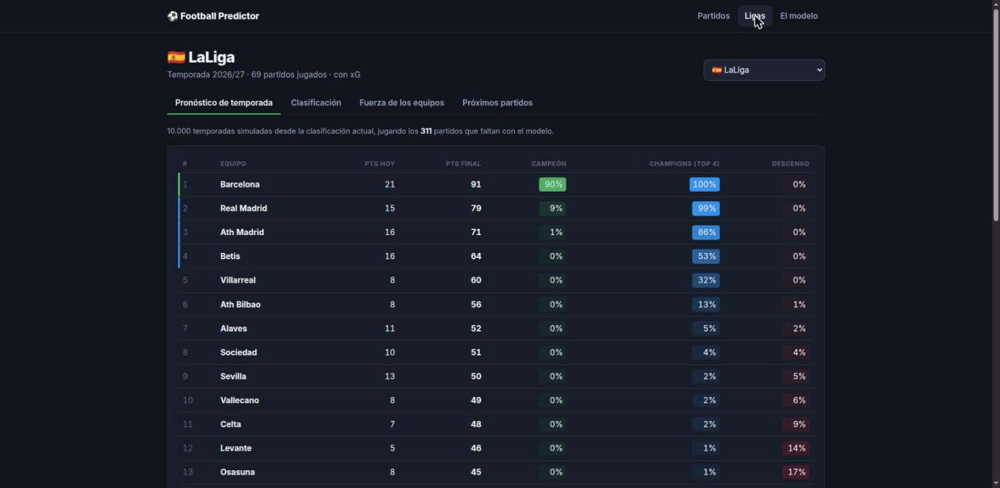
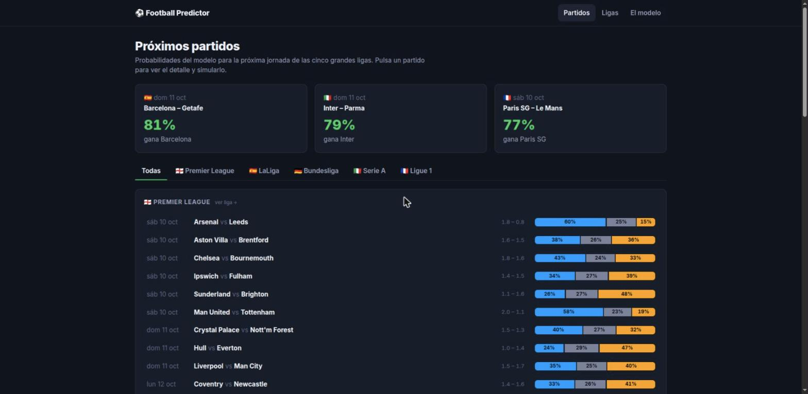
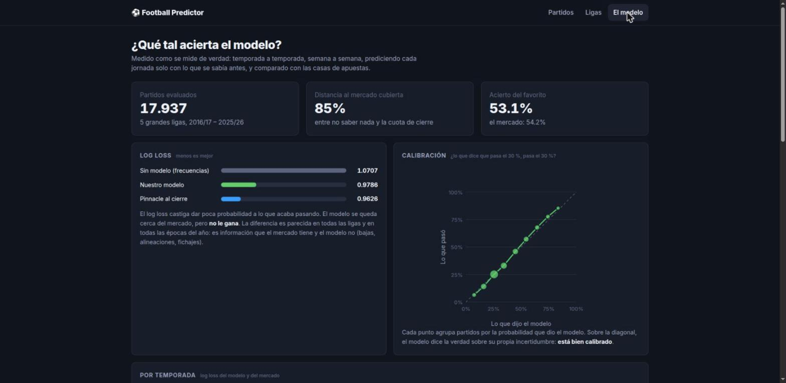

# Football Predictor

Probabilidades de partidos de fútbol con un modelo **Dixon-Coles que aprende de los precios
de los partidos ya jugados**, simulación de temporadas completas y un backtest honesto contra
las casas de apuestas.

- **95.000 partidos** de 12 ligas europeas desde 2005/06, con xG por partido de las cinco
  grandes desde 2014.
- **Medido de verdad**: 10 temporadas, semana a semana, prediciendo cada jornada solo con el
  pasado. El modelo cubre el **92,6 %** de la distancia entre no saber nada y la cuota de
  cierre de Pinnacle (con goles y xG llegaba al 85 %), y está bien calibrado. **No le gana al
  mercado**, y el README lo dice.
- **Simuladores**: la temporada que queda (10.000 veces en medio segundo), un partido minuto
  a minuto y las probabilidades en directo según el marcador.

| Partido | Pronóstico de temporada |
|---|---|
|  |  |
| **Próxima jornada** | **El modelo, medido** |
|  |  |

## Resultados

Walk-forward 2016/17 – 2025/26, cinco grandes ligas, 17.937 partidos. Log loss, menos es mejor:

| | log loss | RPS |
|---|---|---|
| Sin modelo (frecuencias 1X2) | 1,0700 | — |
| Dixon-Coles sobre goles y xG (50 % cada uno) | 0,9785 | 0,1985 |
| **Dixon-Coles sobre los precios de los partidos ya jugados** | **0,9705** | **0,1961** |
| Pinnacle, cuota de cierre | 0,9626 | 0,1937 |

- **Por qué precios**: una cuota ya sabe las bajas, las alineaciones y los fichajes, que es lo
  que le faltaba al modelo de goles y xG. Cada precio de un partido jugado se convierte en los
  goles esperados que lo reproducen, y el modelo aprende de ellos con una vida media de unas
  tres semanas. Mejora en las 10 temporadas y en las 5 ligas; sumarle goles o xG ya no aporta.
  El partido que se predice nunca ve su propio precio.
- **Calibración**: agrupando por la probabilidad del modelo, lo que dice que pasa el 25,5 %
  pasa el 25,9 %, y en ningún tramo con más de 1.000 casos se aparta más de 1,6 puntos.
- **Apuestas**: apostar cuando el modelo ve valor, a cuota media previa al partido, pierde entre
  un 7,5 % y un 10 % en 10 temporadas (apostar a todo pierde el 6,4 %, el margen de la casa).
  Lo que le queda al mercado es lo que se sabe la semana del partido: alineaciones y bajas de
  última hora.

Todo el detalle, con gráficos, en la página **El modelo** de la app.

## Contra las casas de apuestas

Con datos públicos el modelo no le gana al mercado en ningún sitio: medido en 12 ligas y
tres mercados (1X2, goles, hándicap asiático) con valor esperado contra la cuota de cierre
(`backend/edge.py`, con el modelo de goles y xG), tampoco añadiendo las bajas de API-Football
(`backend/injuries.py`) y tampoco con el modelo de precios, que solo se acerca más.

Lo que hacen los profesionales es otra cosa: tomar la casa más afilada (Pinnacle) como
verdad y buscar casas que se quedan atrás. `backend/odds_live.py` lo hace en vivo con
[The Odds API](https://the-odds-api.com): ~19 casas en 12 ligas, probabilidad justa por el
método de potencia (el proporcional sobrevalora a los tapados), y cada precio con valor
queda registrado para puntuarlo contra el cierre. Consultas programadas con cron
(`backend/cron_snapshot.sh`). Páginas *Valor* y *Mercado* (en cada partido) en la web.

## Cómo funciona

1. **Datos** (`backend/ingest.py`): resultados, tiros, tarjetas y cuotas (Bet365, media del
   mercado, Pinnacle y cierre) de [football-data.co.uk](https://www.football-data.co.uk), y
   xG de [Understat](https://understat.com). Los nombres de equipo de las dos fuentes se
   emparejan **aprendiendo de los propios partidos** (mismo día, mismo marcador): 100 % de cruce.
   Todo queda en una SQLite local.
2. **Precios** (`backend/market.py`): cada cuota de un partido jugado (1X2 y más/menos 2,5,
   sin margen por el método de potencia) se convierte en los dos goles esperados que la
   reproducen con el mismo Dixon-Coles: mínimos cuadrados sobre una rejilla de 700×700 pares,
   los 95.000 partidos en medio segundo.
3. **Modelo** (`backend/ratings.py`): cada equipo tiene ataque y defensa; los goles son
   Poisson con la corrección de Dixon & Coles (1997) para marcadores bajos. Se ajusta por máxima
   verosimilitud con gradiente analítico sobre esos goles esperados, pesando más lo reciente
   (vida media ~3 semanas: un precio caduca rápido), con las segundas divisiones en el mismo
   ajuste para que los ascendidos lleguen con un rating real. Admite también goles y xG, cada
   señal con su propio decaimiento: es el modelo de referencia sin mercado.
4. **Backtest** (`backend/backtest.py`): reajuste semanal solo con el pasado, comparado con las
   probabilidades del mercado sin margen. Un test comprueba que cambiar un resultado futuro no
   altera ninguna predicción anterior.
5. **Simuladores** (`backend/simulate.py`): temporada completa vectorizada con desempates por
   diferencia de goles, partido minuto a minuto y repetición de apuestas con CLV.
6. **Córners y tiros a puerta** (`backend/props.py`): binomial negativa por equipo, a partir
   de los goles esperados y de unos ratings Dixon-Coles ajustados sobre los propios córners y
   tiros (el estilo: hay equipos que viven del córner). Medido sin mirar el futuro en 17.935
   partidos: el combinado es mejor que cada parte por separado, y la probabilidad de cada línea
   de total se aparta menos de 3 puntos de lo que pasó. Las mitades reparten el partido como
   los goles: no hay datos por mitad para medirlo.
7. **API** (`backend/api.py` + `engine.py`, FastAPI) y **web** (`frontend/`, SvelteKit 2 +
   Svelte 5, gráficos en SVG sin librerías).

## Arrancar

```bash
python3 -m venv .venv && .venv/bin/pip install -r backend/requirements-dev.txt
cd backend
../.venv/bin/python ingest.py                  # ~5 min la primera vez, luego usa la caché
../.venv/bin/python backtest.py --joint --xg 0 --market 1 --market-xi 0.03 --prior 10 --name dc_market
                                               # ~2 min, alimenta la página "El modelo"
../.venv/bin/python props.py                    # ~2 min, córners y tiros a puerta
../.venv/bin/python -m uvicorn api:app --port 8000

cd ../frontend && bun install && bun run dev   # http://localhost:5173
```

Cuotas en vivo: `ODDS_API_KEY` de [The Odds API](https://the-odds-api.com) (gratis, 500
créditos al mes) en `backend/.env`, y `python odds_live.py snapshot`.

Marcadores en directo: clave gratuita de [football-data.org](https://www.football-data.org) en
`backend/.env` como `FOOTBALL_DATA_KEY=...`. Actualizar datos: `python ingest.py --refresh`
y `POST /api/reload`.

Tests: `cd backend && ../.venv/bin/python -m pytest -q` (48 tests, sin red).

## API

| Método | Ruta | Qué devuelve |
|---|---|---|
| GET | `/api/leagues` | ligas disponibles |
| GET | `/api/leagues/{code}/table` | clasificación actual con forma |
| GET | `/api/leagues/{code}/ratings` | ataque, defensa y balance de cada equipo |
| GET | `/api/leagues/{code}/fixtures?limit=10` | próximos partidos con probabilidades (se guardan para medir el modelo en vivo) |
| GET | `/api/leagues/{code}/forecast` | temporada simulada: puntos esperados, campeón, top 4, descenso y probabilidad de cada puesto |
| POST | `/api/predict` | un partido: 1X2, mercados, matriz de marcadores, forma con xG, H2H |
| POST | `/api/predict/inplay` | probabilidades desde un marcador y un minuto |
| POST | `/api/simulate/match` | un partido simulado minuto a minuto |
| GET | `/api/backtest` | resumen del backtest |
| GET | `/api/live` | partidos de hoy (football-data.org) |

## Demo estática (sin servidor)

La web también se compila como sitio estático para GitHub Pages: `backend/export_static.py`
vuelca a JSON (1,3 MB) lo que no se puede calcular en el navegador —las fuerzas de cada
pareja, clasificaciones, pronósticos de temporada y el backtest— y las matrices de
marcadores, los mercados, el directo y el simulador se calculan en TypeScript
(`frontend/src/lib/dixoncoles.ts`, idéntico a Python a 6 decimales). Las cuotas en vivo no
se publican (son de uso personal según The Odds API), así que *Valor* y *Directo* solo
existen en local.

```bash
cd backend && ../.venv/bin/python export_static.py
cd ../frontend && BASE_PATH=/football-predictor bun run build:static    # -> build/
```

Lo pendiente está en [ROADMAP.md](ROADMAP.md).
